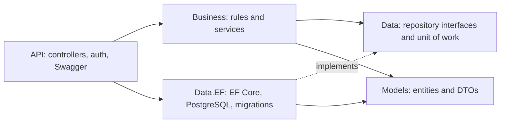

# iRacing League API

[](https://github.com/shezcode/IRacingLeagueAPI/actions/workflows/ci.yml)

A .NET 10 REST API for running sim-racing leagues. Drivers join public or invite-only leagues,
owners schedule races and submit full classifications, and the API derives points, standings, and
driver ratings from the race history.

This project began as a layered class project for the DWES web-development module. It has since
been extended into a PostgreSQL-backed API with authentication, concurrency controls, CSV imports,
and replayable rating calculations.

> **Live demo:** Deployment to a self-managed VPS is planned. The API has not been deployed yet, so
> a live Swagger URL is not available. Run it locally using the instructions below.

## Try it locally

1. Copy `.env.example` to `.env`.
2. Replace the database password and JWT key placeholders. Use the same database password in both
   database settings, and make the JWT key at least 32 bytes long.
3. Start the API and PostgreSQL:

   ```sh
   docker compose up --build
   ```

4. Open [http://localhost:8009](http://localhost:8009) for Swagger UI. PostgreSQL is available on
   port `9008`.

The database schema migrates on startup. When it is empty, the API seeds a demo league dataset.
Set `Demo__Enabled=true` in `.env` to reset and reseed the demo on startup and every 24 hours.
Without demo mode, seeding runs only against an empty database.

To reset the local database volume, run `docker compose down -v` before starting the stack again.

### Demo accounts

| Role | Email | Password |
|---|---|---|
| Admin | `admin@iracingleague.com` | `Admin123!` |
| Driver | `max@example.com` | `Demo123!` |
| Driver | `lewis@example.com` | `Demo123!` |

Other seeded drivers use the same `Demo123!` password. Admin and driver accounts can create
leagues, schedule races, issue invites, and submit results through Swagger.

## What it does

- Public driver profiles never expose email. Signed-in drivers can read their private profile,
  update their username and tag, browse their leagues, and see career stats filtered to leagues
  they can view.
- Public leagues can be joined directly. Private leagues require a single-use invite with an
  expiry. Invite tokens are returned once and only their SHA-256 hashes are stored.
- League owners submit a complete race classification at once. The API validates positions,
  drivers, DNFs, race dates, and ranges, then calculates points and fastest-lap bonuses.
- League points rules can be changed; existing results are rescored in the same transaction.
- iRating-style Elo changes, Safety Rating changes, license class, wins, and standings are derived
  from completed race results. Correcting or deleting earlier results replays subsequent races
  across leagues. These are project-defined, iRacing-inspired rules; they do not reproduce
  iRacing's proprietary rating algorithm.
- CSV classification import supports preview, quoted notes, and row-level parsing errors.
- Database cascades remove dependent data, while rating replay restores affected drivers from the
  remaining race history.
- League and race updates support ETags and optional `If-Match` headers to detect stale edits.
- Authentication uses salted, versioned password hashes, 15-minute access tokens, and rotating
  14-day refresh tokens. Reuse revokes the token family.
- Errors use RFC 7807 problem documents with a trace ID. List endpoints are paginated.

## API map

All application routes are under `/api/v1`; health probes are not versioned.

| Area | Routes |
|---|---|
| Authentication | `/auth/register`, `/auth/login`, `/auth/refresh`, `/auth/logout` |
| Current driver | `/me`, `/me/leagues` |
| Drivers | `/drivers`, `/drivers/{id}`, `/drivers/{id}/stats` |
| Leagues | `/leagues`, `/leagues/{id}`, `/leagues/{id}/members`, `/leagues/{id}/standings`, `/leagues/{id}/invites`, `/leagues/{id}/races` |
| Races | `/races/{id}`, `/races/{id}/results`, `/races/{id}/results/import` |
| Health | `/health/live`, `/health/ready` |

## Architecture



The solution keeps the original five-project shape: `Models`, `Data`, `Data.EF`, `Business`, and
`API`. Business depends on repository contracts and contains no EF Core references. The API
composition root wires those contracts to the PostgreSQL implementation.

## Development details

- Runtime: .NET 10, ASP.NET Core, EF Core 10, PostgreSQL 17.
- Local infrastructure: Docker Compose with a database health check, startup migrations, and
  ignored environment secrets.
- CI: the GitHub Actions workflow builds the Release solution and API container for pull requests
  and pushes to `main`.
- Hosting: the deployment target is a self-managed VPS. The public URL and production configuration
  will be documented after deployment. Production secrets belong in the VPS environment, and
  forwarded client IPs should be trusted only from the actual reverse proxy in front of the API.
- There are no automated tests by design. The acceptance checks for this spec are manual API
  walkthroughs against PostgreSQL.

Key design decisions are recorded in [`docs/adr`](docs/adr/). The implementation spec and historical
planning notes are kept under [`docs/planning`](docs/planning/).
